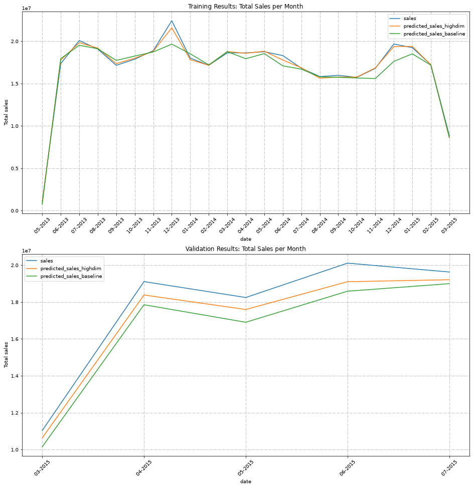
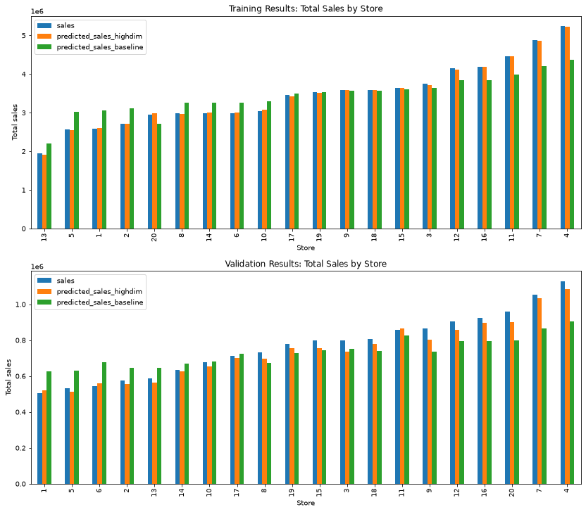

# High Dimensional Fixed Effects with Rossman Sales Data

**Intro**

This tutorial demonstrates how to create models with high dimensional fixed effects using `glum`. Using `tabmat`, we can pass categorical variables with a large range of values. `glum` and `tabmat` will handle the creation of the one-hot-encoded design matrix.

In some real-world problems, we have used millions of categories. This would be impossible with a dense matrix. General-purpose sparse matrices like compressed sparse row (CSR) matrices help but still leave a lot on the table. For a categorical matrix, we know that each row has only a single non-zero value and that value is 1. These optimizations are implemented in `tabmat.CategoricalMatrix`.

**Background**

For this tutorial, we will be predicting sales for the European drug store chain Rossman. Specifically, we are tasked with predicting daily sales for future dates. Ideally, we want a model that can capture the many factors that influence stores sales -- promotions, competition, school, holidays, seasonality, etc. As a baseline, we will start with a simple model that only uses a few basic predictors. Then, we will fit a model with a large number of fixed effects. For both models, we will use OLS with L2 regularization.

We will use a gamma distribution for our model. This choice is motivated by two main factors. First, our target variable, sales, is a positive real number, which matches the support of the gamma distribution. Second, it is expected that factors influencing sales are multiplicative rather than additive, which is better captured with a gamma regression than say, OLS.

*Note*: a few parts of this tutorial utilize local helper functions outside this notebook. If you wish to run the notebook on your own, you can find the rest of the code [here](https://github.com/Quantco/glum/tree/main/docs/tutorials/rossman).

```python
import os
from pathlib import Path

import matplotlib.pyplot as plt
import numpy as np
import pandas as pd

from dask_ml.impute import SimpleImputer
from dask_ml.preprocessing import Categorizer
from glum import GeneralizedLinearRegressor
from sklearn.pipeline import Pipeline

from feature_engineering import apply_all_transformations
from process_data import load_test, load_train, process_data

import sys
sys.path.append("../")
from metrics import root_mean_squared_percentage_error

pd.set_option("display.float_format", lambda x: "%.3f" % x)
pd.set_option('display.max_columns', None)
```

## 1. Data loading and feature engineering

We start by loading in the raw data. If you have not yet processed the raw data, it will be done below. (Initial processing consists of some basic cleaning and renaming of columns.

*Note*: if you wish to run this notebook on your own, and have not done so already, please download the data from the [Rossman Kaggle Challenge](https://www.kaggle.com/c/rossmann-store-sales). This tutorial expects that it in a folder named "raw_data" under the same directory as the notebook.

### 1.1 Load

```python
if not all(Path(p).exists() for p in ["raw_data/train.csv", "raw_data/test.csv", "raw_data/store.csv"]):
    raise Exception("Please download raw data into 'raw_data' folder")

if not all(Path(p).exists() for p in ["processed_data/train.parquet", "processed_data/test.parquet"]):
    "Processed data not found. Processing data from raw data..."
    process_data()
    "Done"

df = load_train().sort_values(["store", "date"])
df = df.iloc[:int(.1*len(df))]
df.head()
```

<div class="nb-output">
<div>
<table border="1" class="dataframe">
  <thead>
    <tr style="text-align: right;">
      <th></th>
      <th>store</th>
      <th>day_of_week</th>
      <th>date</th>
      <th>sales</th>
      <th>customers</th>
      <th>open</th>
      <th>promo</th>
      <th>state_holiday</th>
      <th>school_holiday</th>
      <th>year</th>
      <th>month</th>
      <th>store_type</th>
      <th>assortment</th>
      <th>competition_distance</th>
      <th>competition_open_since_month</th>
      <th>competition_open_since_year</th>
      <th>promo2</th>
      <th>promo2_since_week</th>
      <th>promo2_since_year</th>
      <th>promo_interval</th>
    </tr>
  </thead>
  <tbody>
    <tr>
      <th>1016095</th>
      <td>1</td>
      <td>2</td>
      <td>2013-01-01</td>
      <td>0</td>
      <td>0</td>
      <td>False</td>
      <td>0</td>
      <td>a</td>
      <td>1</td>
      <td>2013</td>
      <td>1</td>
      <td>c</td>
      <td>a</td>
      <td>1270.000</td>
      <td>9.000</td>
      <td>2008.000</td>
      <td>0</td>
      <td>NaN</td>
      <td>NaN</td>
      <td>NaN</td>
    </tr>
    <tr>
      <th>1014980</th>
      <td>1</td>
      <td>3</td>
      <td>2013-01-02</td>
      <td>5530</td>
      <td>668</td>
      <td>True</td>
      <td>0</td>
      <td>0</td>
      <td>1</td>
      <td>2013</td>
      <td>1</td>
      <td>c</td>
      <td>a</td>
      <td>1270.000</td>
      <td>9.000</td>
      <td>2008.000</td>
      <td>0</td>
      <td>NaN</td>
      <td>NaN</td>
      <td>NaN</td>
    </tr>
    <tr>
      <th>1013865</th>
      <td>1</td>
      <td>4</td>
      <td>2013-01-03</td>
      <td>4327</td>
      <td>578</td>
      <td>True</td>
      <td>0</td>
      <td>0</td>
      <td>1</td>
      <td>2013</td>
      <td>1</td>
      <td>c</td>
      <td>a</td>
      <td>1270.000</td>
      <td>9.000</td>
      <td>2008.000</td>
      <td>0</td>
      <td>NaN</td>
      <td>NaN</td>
      <td>NaN</td>
    </tr>
    <tr>
      <th>1012750</th>
      <td>1</td>
      <td>5</td>
      <td>2013-01-04</td>
      <td>4486</td>
      <td>619</td>
      <td>True</td>
      <td>0</td>
      <td>0</td>
      <td>1</td>
      <td>2013</td>
      <td>1</td>
      <td>c</td>
      <td>a</td>
      <td>1270.000</td>
      <td>9.000</td>
      <td>2008.000</td>
      <td>0</td>
      <td>NaN</td>
      <td>NaN</td>
      <td>NaN</td>
    </tr>
    <tr>
      <th>1011635</th>
      <td>1</td>
      <td>6</td>
      <td>2013-01-05</td>
      <td>4997</td>
      <td>635</td>
      <td>True</td>
      <td>0</td>
      <td>0</td>
      <td>1</td>
      <td>2013</td>
      <td>1</td>
      <td>c</td>
      <td>a</td>
      <td>1270.000</td>
      <td>9.000</td>
      <td>2008.000</td>
      <td>0</td>
      <td>NaN</td>
      <td>NaN</td>
      <td>NaN</td>
    </tr>
  </tbody>
</table>
</div>
</div>

### 1.2 Feature engineering

As mentioned earlier, we want our model to incorporate many factors that could influence store sales. We create a number of fixed effects to capture this information. These include fixed effects for:

- A certain number days before a school or state holiday
- A certain number days after a school or state holiday
- A certain number days before a promo
- A certain number days after a promo
- A certain number days before the store is open or closed
- A certain number days after the store is open or closed
- Each month for each store
- Each year for each store
- Each day of the week for each store

We also do several other transformations like computing the z score to eliminate outliers (in the next step)

```python
df = apply_all_transformations(df)
df.head()
```

<div class="nb-output">
<div>
<table border="1" class="dataframe">
  <thead>
    <tr style="text-align: right;">
      <th></th>
      <th>store</th>
      <th>day_of_week</th>
      <th>date</th>
      <th>sales</th>
      <th>customers</th>
      <th>open</th>
      <th>promo</th>
      <th>state_holiday</th>
      <th>school_holiday</th>
      <th>year</th>
      <th>month</th>
      <th>store_type</th>
      <th>assortment</th>
      <th>competition_distance</th>
      <th>competition_open_since_month</th>
      <th>competition_open_since_year</th>
      <th>promo2</th>
      <th>promo2_since_week</th>
      <th>promo2_since_year</th>
      <th>promo_interval</th>
      <th>age_quantile</th>
      <th>competition_open</th>
      <th>count</th>
      <th>open_lag_1</th>
      <th>open_lag_2</th>
      <th>open_lag_3</th>
      <th>open_lead_1</th>
      <th>open_lead_2</th>
      <th>open_lead_3</th>
      <th>promo_lag_1</th>
      <th>promo_lag_2</th>
      <th>promo_lag_3</th>
      <th>promo_lead_1</th>
      <th>promo_lead_2</th>
      <th>promo_lead_3</th>
      <th>school_holiday_lag_1</th>
      <th>school_holiday_lag_2</th>
      <th>school_holiday_lag_3</th>
      <th>school_holiday_lead_1</th>
      <th>school_holiday_lead_2</th>
      <th>school_holiday_lead_3</th>
      <th>state_holiday_lag_1</th>
      <th>state_holiday_lag_2</th>
      <th>state_holiday_lag_3</th>
      <th>state_holiday_lead_1</th>
      <th>state_holiday_lead_2</th>
      <th>state_holiday_lead_3</th>
      <th>store_day_of_week</th>
      <th>store_month</th>
      <th>store_school_holiday</th>
      <th>store_state_holiday</th>
      <th>store_year</th>
      <th>zscore</th>
    </tr>
  </thead>
  <tbody>
    <tr>
      <th>1016095</th>
      <td>1</td>
      <td>2</td>
      <td>2013-01-01</td>
      <td>0</td>
      <td>0</td>
      <td>False</td>
      <td>0</td>
      <td>a</td>
      <td>1</td>
      <td>2013</td>
      <td>1</td>
      <td>c</td>
      <td>a</td>
      <td>1270.000</td>
      <td>9.000</td>
      <td>2008.000</td>
      <td>0</td>
      <td>NaN</td>
      <td>NaN</td>
      <td>NaN</td>
      <td>-1</td>
      <td>1.000</td>
      <td>0</td>
      <td>1.000</td>
      <td>1.000</td>
      <td>1.000</td>
      <td>True</td>
      <td>True</td>
      <td>True</td>
      <td>0.000</td>
      <td>0.000</td>
      <td>0.000</td>
      <td>0.000</td>
      <td>0.000</td>
      <td>0.000</td>
      <td>0.000</td>
      <td>0.000</td>
      <td>0.000</td>
      <td>1.000</td>
      <td>1.000</td>
      <td>1.000</td>
      <td>0</td>
      <td>0</td>
      <td>0</td>
      <td>0</td>
      <td>0</td>
      <td>0</td>
      <td>1_2</td>
      <td>1_1</td>
      <td>1_1</td>
      <td>1_True</td>
      <td>1_2013</td>
      <td>NaN</td>
    </tr>
    <tr>
      <th>1014980</th>
      <td>1</td>
      <td>3</td>
      <td>2013-01-02</td>
      <td>5530</td>
      <td>668</td>
      <td>True</td>
      <td>0</td>
      <td>0</td>
      <td>1</td>
      <td>2013</td>
      <td>1</td>
      <td>c</td>
      <td>a</td>
      <td>1270.000</td>
      <td>9.000</td>
      <td>2008.000</td>
      <td>0</td>
      <td>NaN</td>
      <td>NaN</td>
      <td>NaN</td>
      <td>-1</td>
      <td>1.000</td>
      <td>1</td>
      <td>False</td>
      <td>1.000</td>
      <td>1.000</td>
      <td>True</td>
      <td>True</td>
      <td>True</td>
      <td>0.000</td>
      <td>0.000</td>
      <td>0.000</td>
      <td>0.000</td>
      <td>0.000</td>
      <td>0.000</td>
      <td>1.000</td>
      <td>0.000</td>
      <td>0.000</td>
      <td>1.000</td>
      <td>1.000</td>
      <td>1.000</td>
      <td>a</td>
      <td>0</td>
      <td>0</td>
      <td>0</td>
      <td>0</td>
      <td>0</td>
      <td>1_3</td>
      <td>1_1</td>
      <td>1_1</td>
      <td>1_False</td>
      <td>1_2013</td>
      <td>NaN</td>
    </tr>
    <tr>
      <th>1013865</th>
      <td>1</td>
      <td>4</td>
      <td>2013-01-03</td>
      <td>4327</td>
      <td>578</td>
      <td>True</td>
      <td>0</td>
      <td>0</td>
      <td>1</td>
      <td>2013</td>
      <td>1</td>
      <td>c</td>
      <td>a</td>
      <td>1270.000</td>
      <td>9.000</td>
      <td>2008.000</td>
      <td>0</td>
      <td>NaN</td>
      <td>NaN</td>
      <td>NaN</td>
      <td>-1</td>
      <td>1.000</td>
      <td>2</td>
      <td>True</td>
      <td>False</td>
      <td>1.000</td>
      <td>True</td>
      <td>True</td>
      <td>False</td>
      <td>0.000</td>
      <td>0.000</td>
      <td>0.000</td>
      <td>0.000</td>
      <td>0.000</td>
      <td>0.000</td>
      <td>1.000</td>
      <td>1.000</td>
      <td>0.000</td>
      <td>1.000</td>
      <td>1.000</td>
      <td>1.000</td>
      <td>0</td>
      <td>a</td>
      <td>0</td>
      <td>0</td>
      <td>0</td>
      <td>0</td>
      <td>1_4</td>
      <td>1_1</td>
      <td>1_1</td>
      <td>1_False</td>
      <td>1_2013</td>
      <td>NaN</td>
    </tr>
    <tr>
      <th>1012750</th>
      <td>1</td>
      <td>5</td>
      <td>2013-01-04</td>
      <td>4486</td>
      <td>619</td>
      <td>True</td>
      <td>0</td>
      <td>0</td>
      <td>1</td>
      <td>2013</td>
      <td>1</td>
      <td>c</td>
      <td>a</td>
      <td>1270.000</td>
      <td>9.000</td>
      <td>2008.000</td>
      <td>0</td>
      <td>NaN</td>
      <td>NaN</td>
      <td>NaN</td>
      <td>-1</td>
      <td>1.000</td>
      <td>3</td>
      <td>True</td>
      <td>True</td>
      <td>False</td>
      <td>True</td>
      <td>False</td>
      <td>True</td>
      <td>0.000</td>
      <td>0.000</td>
      <td>0.000</td>
      <td>0.000</td>
      <td>0.000</td>
      <td>1.000</td>
      <td>1.000</td>
      <td>1.000</td>
      <td>1.000</td>
      <td>1.000</td>
      <td>1.000</td>
      <td>1.000</td>
      <td>0</td>
      <td>0</td>
      <td>a</td>
      <td>0</td>
      <td>0</td>
      <td>0</td>
      <td>1_5</td>
      <td>1_1</td>
      <td>1_1</td>
      <td>1_False</td>
      <td>1_2013</td>
      <td>NaN</td>
    </tr>
    <tr>
      <th>1011635</th>
      <td>1</td>
      <td>6</td>
      <td>2013-01-05</td>
      <td>4997</td>
      <td>635</td>
      <td>True</td>
      <td>0</td>
      <td>0</td>
      <td>1</td>
      <td>2013</td>
      <td>1</td>
      <td>c</td>
      <td>a</td>
      <td>1270.000</td>
      <td>9.000</td>
      <td>2008.000</td>
      <td>0</td>
      <td>NaN</td>
      <td>NaN</td>
      <td>NaN</td>
      <td>-1</td>
      <td>1.000</td>
      <td>4</td>
      <td>True</td>
      <td>True</td>
      <td>True</td>
      <td>False</td>
      <td>True</td>
      <td>True</td>
      <td>0.000</td>
      <td>0.000</td>
      <td>0.000</td>
      <td>0.000</td>
      <td>1.000</td>
      <td>1.000</td>
      <td>1.000</td>
      <td>1.000</td>
      <td>1.000</td>
      <td>1.000</td>
      <td>1.000</td>
      <td>1.000</td>
      <td>0</td>
      <td>0</td>
      <td>0</td>
      <td>0</td>
      <td>0</td>
      <td>0</td>
      <td>1_6</td>
      <td>1_1</td>
      <td>1_1</td>
      <td>1_False</td>
      <td>1_2013</td>
      <td>NaN</td>
    </tr>
  </tbody>
</table>
</div>
</div>

### 1.3 Train vs. validation selection

Lastly, we split our data into training and validation sets. Kaggle provides a test set for the Rossman challenge, but it does not directly include outcome data (sales), so we do not use it for our tutorial. Instead, we simulate predicting future sales by taking the last 5 months of our training data as our validation set.

```python
validation_window = [pd.to_datetime("2015-03-15"), pd.to_datetime("2015-07-31")]
select_train = (df["sales"].gt(0) & df["date"].lt(validation_window[0]) & df["zscore"].abs().lt(5)).to_numpy()

select_val = (
    df["sales"].gt(0)
    & df["date"].ge(validation_window[0])
    & df["date"].lt(validation_window[1])
).to_numpy()

(select_train.sum(), select_val.sum())
```

```text
(np.int64(57876), np.int64(12502))
```

## 2. Fit baseline GLM

We start with a simple model that uses only year, month, day of the week, and store as predictors. Even with these variables alone, we should still be able to capture a lot of valuable information. Year can capture overall sales trends, month can capture seasonality, week day can capture the variation in sales across the week, and store can capture locality. We will treat these all as categorical variables.

With the `GeneralizedLinearRegressor()` class, we can pass in `pandas.Categorical` variables directly without having to encode them ourselves. This is convenient, especially when we start adding more fixed effects. But it is very important that the categories are aligned between calls to `fit` and `predict`. One way of achieving this alignment is with a `dask_ml.preprocessing.Categorizer`. Note, however, that the `Categorizer` class fails to enforce category alignment if the input column is already a categorical data type.

You can reference the [pandas documentation on Categoricals](https://pandas.pydata.org/pandas-docs/stable/user_guide/categorical.html) to learn more about how these data types work.

```python
baseline_features = ["year", "month", "day_of_week", "store"]
baseline_categorizer = Categorizer(columns=baseline_features)
baseline_glm = GeneralizedLinearRegressor(
    family="gamma",
    scale_predictors=True,
    l1_ratio=0.0,
    alpha=1.0,
)
```

Fit the model making sure to process the data frame with the Categorizer first and inspect the coefficients.

```python
baseline_glm.fit(
    baseline_categorizer.fit_transform(df[select_train][baseline_features]),
    df.loc[select_train, "sales"]
)

pd.DataFrame(
    {'coefficient': np.concatenate(([baseline_glm.intercept_], baseline_glm.coef_))},
    index=['intercept'] + baseline_glm.feature_names_
).T
```

<div class="nb-output">
<div>
<table border="1" class="dataframe">
  <thead>
    <tr style="text-align: right;">
      <th></th>
      <th>intercept</th>
      <th>year[2013]</th>
      <th>year[2014]</th>
      <th>year[2015]</th>
      <th>month[1]</th>
      <th>month[2]</th>
      <th>month[3]</th>
      <th>month[4]</th>
      <th>month[5]</th>
      <th>month[6]</th>
      <th>month[7]</th>
      <th>month[8]</th>
      <th>month[9]</th>
      <th>month[10]</th>
      <th>month[11]</th>
      <th>month[12]</th>
      <th>day_of_week[1]</th>
      <th>day_of_week[2]</th>
      <th>day_of_week[3]</th>
      <th>day_of_week[4]</th>
      <th>day_of_week[5]</th>
      <th>day_of_week[6]</th>
      <th>day_of_week[7]</th>
      <th>store[1]</th>
      <th>store[2]</th>
      <th>store[3]</th>
      <th>store[4]</th>
      <th>store[5]</th>
      <th>store[6]</th>
      <th>store[7]</th>
      <th>store[8]</th>
      <th>store[9]</th>
      <th>store[10]</th>
      <th>store[11]</th>
      <th>store[12]</th>
      <th>store[13]</th>
      <th>store[14]</th>
      <th>store[15]</th>
      <th>store[16]</th>
      <th>store[17]</th>
      <th>store[18]</th>
      <th>store[19]</th>
      <th>store[20]</th>
      <th>store[21]</th>
      <th>store[22]</th>
      <th>store[23]</th>
      <th>store[24]</th>
      <th>store[25]</th>
      <th>store[26]</th>
      <th>store[27]</th>
      <th>store[28]</th>
      <th>store[29]</th>
      <th>store[30]</th>
      <th>store[31]</th>
      <th>store[32]</th>
      <th>store[33]</th>
      <th>store[34]</th>
      <th>store[35]</th>
      <th>store[36]</th>
      <th>store[37]</th>
      <th>store[38]</th>
      <th>store[39]</th>
      <th>store[40]</th>
      <th>store[41]</th>
      <th>store[42]</th>
      <th>store[43]</th>
      <th>store[44]</th>
      <th>store[45]</th>
      <th>store[46]</th>
      <th>store[47]</th>
      <th>store[48]</th>
      <th>store[49]</th>
      <th>store[50]</th>
      <th>store[51]</th>
      <th>store[52]</th>
      <th>store[53]</th>
      <th>store[54]</th>
      <th>store[55]</th>
      <th>store[56]</th>
      <th>store[57]</th>
      <th>store[58]</th>
      <th>store[59]</th>
      <th>store[60]</th>
      <th>store[61]</th>
      <th>store[62]</th>
      <th>store[63]</th>
      <th>store[64]</th>
      <th>store[65]</th>
      <th>store[66]</th>
      <th>store[67]</th>
      <th>store[68]</th>
      <th>store[69]</th>
      <th>store[70]</th>
      <th>store[71]</th>
      <th>store[72]</th>
      <th>store[73]</th>
      <th>store[74]</th>
      <th>store[75]</th>
      <th>store[76]</th>
      <th>store[77]</th>
      <th>store[78]</th>
      <th>store[79]</th>
      <th>store[80]</th>
      <th>store[81]</th>
      <th>store[82]</th>
      <th>store[83]</th>
      <th>store[84]</th>
      <th>store[85]</th>
      <th>store[86]</th>
      <th>store[87]</th>
      <th>store[88]</th>
      <th>store[89]</th>
      <th>store[90]</th>
      <th>store[91]</th>
      <th>store[92]</th>
      <th>store[93]</th>
      <th>store[94]</th>
      <th>store[95]</th>
      <th>store[96]</th>
      <th>store[97]</th>
      <th>store[98]</th>
      <th>store[99]</th>
      <th>store[100]</th>
      <th>store[101]</th>
      <th>store[102]</th>
      <th>store[103]</th>
      <th>store[104]</th>
      <th>store[105]</th>
      <th>store[106]</th>
      <th>store[107]</th>
      <th>store[108]</th>
      <th>store[109]</th>
      <th>store[110]</th>
      <th>store[111]</th>
      <th>store[112]</th>
    </tr>
  </thead>
  <tbody>
    <tr>
      <th>coefficient</th>
      <td>8.781</td>
      <td>-0.010</td>
      <td>0.008</td>
      <td>0.003</td>
      <td>-0.015</td>
      <td>-0.021</td>
      <td>-0.019</td>
      <td>0.020</td>
      <td>0.008</td>
      <td>-0.006</td>
      <td>-0.002</td>
      <td>-0.023</td>
      <td>-0.034</td>
      <td>-0.030</td>
      <td>0.022</td>
      <td>0.116</td>
      <td>0.098</td>
      <td>0.010</td>
      <td>-0.014</td>
      <td>-0.014</td>
      <td>0.017</td>
      <td>-0.100</td>
      <td>0.285</td>
      <td>-0.156</td>
      <td>-0.136</td>
      <td>0.024</td>
      <td>0.202</td>
      <td>-0.161</td>
      <td>-0.087</td>
      <td>0.158</td>
      <td>-0.094</td>
      <td>0.002</td>
      <td>-0.081</td>
      <td>0.110</td>
      <td>0.074</td>
      <td>-0.126</td>
      <td>-0.088</td>
      <td>0.009</td>
      <td>0.082</td>
      <td>-0.020</td>
      <td>0.001</td>
      <td>-0.008</td>
      <td>0.085</td>
      <td>-0.088</td>
      <td>-0.178</td>
      <td>-0.088</td>
      <td>0.183</td>
      <td>0.274</td>
      <td>0.008</td>
      <td>0.192</td>
      <td>-0.098</td>
      <td>0.059</td>
      <td>-0.101</td>
      <td>-0.051</td>
      <td>-0.225</td>
      <td>0.125</td>
      <td>0.102</td>
      <td>0.198</td>
      <td>0.185</td>
      <td>0.046</td>
      <td>-0.048</td>
      <td>-0.153</td>
      <td>-0.128</td>
      <td>-0.085</td>
      <td>0.234</td>
      <td>0.017</td>
      <td>-0.086</td>
      <td>-0.101</td>
      <td>-0.094</td>
      <td>0.039</td>
      <td>-0.243</td>
      <td>0.058</td>
      <td>-0.208</td>
      <td>0.012</td>
      <td>0.079</td>
      <td>-0.109</td>
      <td>0.099</td>
      <td>-0.180</td>
      <td>0.047</td>
      <td>0.259</td>
      <td>-0.017</td>
      <td>-0.091</td>
      <td>0.102</td>
      <td>-0.149</td>
      <td>-0.009</td>
      <td>0.034</td>
      <td>0.251</td>
      <td>-0.122</td>
      <td>-0.035</td>
      <td>0.086</td>
      <td>0.081</td>
      <td>0.190</td>
      <td>0.002</td>
      <td>0.171</td>
      <td>-0.189</td>
      <td>-0.173</td>
      <td>-0.023</td>
      <td>-0.038</td>
      <td>0.172</td>
      <td>0.077</td>
      <td>-0.266</td>
      <td>-0.091</td>
      <td>0.077</td>
      <td>0.038</td>
      <td>0.163</td>
      <td>-0.248</td>
      <td>0.369</td>
      <td>0.019</td>
      <td>-0.155</td>
      <td>-0.060</td>
      <td>-0.048</td>
      <td>-0.047</td>
      <td>0.130</td>
      <td>-0.059</td>
      <td>-0.047</td>
      <td>-0.052</td>
      <td>0.038</td>
      <td>0.084</td>
      <td>-0.121</td>
      <td>0.007</td>
      <td>-0.119</td>
      <td>-0.111</td>
      <td>0.108</td>
      <td>0.069</td>
      <td>0.038</td>
      <td>-0.171</td>
      <td>0.233</td>
      <td>-0.175</td>
      <td>0.136</td>
      <td>0.058</td>
      <td>0.284</td>
      <td>-0.006</td>
      <td>-0.174</td>
      <td>0.018</td>
      <td>-0.039</td>
    </tr>
  </tbody>
</table>
</div>
</div>

And let's predict for our test set with the caveat that we will predict 0 for days when the stores are closed!

```python
df.loc[lambda x: x["open"], "predicted_sales_baseline"] = baseline_glm.predict(
    baseline_categorizer.fit_transform(df.loc[lambda x: x["open"]][baseline_features])
)

df["predicted_sales_baseline"] = df["predicted_sales_baseline"].fillna(0)
df["predicted_sales_baseline"] = df["predicted_sales_baseline"]
```

We use root mean squared percentage error (RMSPE) as our performance metric. (Useful for thinking about error relative to total sales of each store).

```python
train_err = root_mean_squared_percentage_error(
    df.loc[select_train, "sales"], df.loc[select_train, "predicted_sales_baseline"]
)
val_err = root_mean_squared_percentage_error(
    df.loc[select_val, "sales"], df.loc[select_val, "predicted_sales_baseline"]
)
print(f'Training Error: {round(train_err, 2)}%')
print(f'Validation Error: {round(val_err, 2)}%')
```

```text
Training Error: 27.96%
Validation Error: 29.57%
```

The results aren't bad for a start, but we can do better :)

## 3. GLM with high dimensional fixed effects

Now, we repeat a similar process to above, but, this time, we take advantage of the full range of categoricals we created in our data transformation step. Since we will create a very large number of fixed effects, we may run into cases where our validation data has categorical values not seen in our training data. In these cases, Dask-ML's `Categorizer` will output null values when transforming the validation columns to the categoricals that were created on the training set. To fix this, we add Dask-ML's  [SimpleImputer](https://ml.dask.org/modules/generated/dask_ml.impute.SimpleImputer.html) to our pipeline.

```python
highdim_features = [
    "age_quantile",
    "competition_open",
    "open_lag_1",
    "open_lag_2",
    "open_lag_3",
    "open_lead_1",
    "open_lead_2",
    "open_lead_3",
    "promo_lag_1",
    "promo_lag_2",
    "promo_lag_3",
    "promo_lead_1",
    "promo_lead_2",
    "promo_lead_3",
    "promo",
    "school_holiday_lag_1",
    "school_holiday_lag_2",
    "school_holiday_lag_3",
    "school_holiday_lead_1",
    "school_holiday_lead_2",
    "school_holiday_lead_3",
    "school_holiday",
    "state_holiday_lag_1",
    "state_holiday_lag_2",
    "state_holiday_lag_3",
    "state_holiday_lead_1",
    "state_holiday_lead_2",
    "state_holiday_lead_3",
    "state_holiday",
    "store_day_of_week",
    "store_month",
    "store_school_holiday",
    "store_state_holiday",
    "store_year",
]
highdim_categorizer = Pipeline([
    ("categorize", Categorizer(columns=highdim_features)),
    ("impute", SimpleImputer(strategy="most_frequent"))
])
highdim_glm = GeneralizedLinearRegressor(
    family="gamma",
    scale_predictors=True,
    l1_ratio=0.0, # only ridge
    alpha=1e-1,
)
```

For reference, we output the total number of predictors after fitting the model. We can see that the number getting a bit larger, so we don't print out the coefficients this time.

```python
highdim_glm.fit(
    highdim_categorizer.fit_transform(df[select_train][highdim_features]),
    df.loc[select_train, "sales"]
)

print(f"Number of predictors: {len(highdim_glm.feature_names_)}")
```

```text
Number of predictors: 2771
```

```python
df.loc[lambda x: x["open"], "predicted_sales_highdim"] = highdim_glm.predict(
    highdim_categorizer.transform(df.loc[lambda x: x["open"]][highdim_features]),
)

df["predicted_sales_highdim"] = df["predicted_sales_highdim"].fillna(0)
df["predicted_sales_highdim"] = df["predicted_sales_highdim"]

train_err = root_mean_squared_percentage_error(
    df.loc[select_train, "sales"], df.loc[select_train, "predicted_sales_highdim"]
)
val_err = root_mean_squared_percentage_error(
    df.loc[select_val, "sales"], df.loc[select_val, "predicted_sales_highdim"]
)
print(f'Training Error: {round(train_err, 2)}%')
print(f'Validation Error: {round(val_err, 2)}%')
```

```text
Training Error: 12.54%
Validation Error: 13.28%
```

From just the RMSPE, we can see a clear improvement from our baseline model.

## 4. Plot results

Finally, to get a better look at our results, we make some plots.

```python
sales_cols = ["sales", "predicted_sales_highdim", "predicted_sales_baseline"]
```

First, we plot true sales and the sales predictions from each model aggregated over month:

```python
_, axs = plt.subplots(2, 1, figsize=(16, 16))

for i, select in enumerate([select_train, select_val]):
    ax = axs[i]
    df_plot_date = df[select].groupby(
        ["year", "month"]
    )[sales_cols].sum().reset_index()

    year_month_date = df_plot_date['month'].map(str)+ '-' + df_plot_date['year'].map(str)
    df_plot_date['year_month'] = pd.to_datetime(year_month_date, format='%m-%Y').dt.strftime('%m-%Y')
    df_plot_date.drop(columns= ["year", "month"], inplace=True)

    df_plot_date.plot(x="year_month", ax=ax)
    ax.set_xticks(range(len(df_plot_date)))
    ax.set_xticklabels(df_plot_date.year_month, rotation=45)
    ax.set_xlabel("date")
    ax.set_ylabel("Total sales")
    ax.grid(True, linestyle='-.')

axs[0].set_title("Training Results: Total Sales per Month")
axs[1].set_title("Validation Results: Total Sales per Month")
plt.show()
```



We can also look at aggregate sales for a subset of stores. We select the first 20 stores and plot in order of increasing sales.

```python
_, axs = plt.subplots(2, 1, figsize=(14, 12))
for i, select in enumerate([select_train, select_val]):
    ax = axs[i]
    df_plot_store = df[select].groupby(
        ["store"]
    )[sales_cols].sum().reset_index()[:20].sort_values(by="sales")

    df_plot_store.plot.bar(x="store", ax=ax)
    ax.set_xlabel("Store")
    ax.set_ylabel("Total sales")

axs[0].set_title("Training Results: Total Sales by Store")
axs[1].set_title("Validation Results: Total Sales by Store")
plt.show()
```



We can see that the high dimensional model is much better at capturing the variation between months and individual stores!
